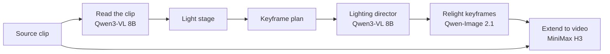

# Open Video Relight

Relight real video in ComfyUI from a 3D light stage.

You place lights on a sphere around your subject, set how they move, and describe each one in your own words. A vision LM reads the clip and your lights together and writes the prompts. Qwen-Image 2.1 relights a few keyframes, and MiniMax H3 carries that light through the clip while keeping the people and their performance.

<!-- Demo video link goes here. -->

## Examples

Four setups are included in [`dev/demo_rigs`](dev/demo_rigs/):

| Setup | Type of change | Result |
|---|---|---|
| [`demo_A.json`](dev/demo_rigs/demo_A.json) | Small adjustment | A flat office becomes low evening sun |
| [`demo_B.json`](dev/demo_rigs/demo_B.json) | Moving, multi-colour light | Magenta and cyan stage lights move over dancers |
| [`demo_C.json`](dev/demo_rigs/demo_C.json) | Lighting reference | A thin warm edge light in a dark room |
| [`demo_D.json`](dev/demo_rigs/demo_D.json) | New background | A dusk rooftop becomes a rainy neon street |

## How it works



1. The LM reads the clip: its lights, openings, surfaces, materials, and which way people face.
2. The detected lights appear on the stage. You keep, change or remove them, and add your own.
3. The keyframes are planned from the lights: two if nothing moves, up to three if something does.
4. The LM plans the mood, what each light really is and how it moves, and writes the video prompt. Each keyframe is then written on its own, from that frame and the light positions at that moment.
5. Qwen-Image 2.1 edits the original frames. You can check them and redraw any one before making the video.
6. MiniMax H3 uses the original clip as its reference and the keyframes as guides.

## Requirements

- ComfyUI with the built-in MiniMax H3 and Qwen-Image 2.1 nodes. Tested on ComfyUI Desktop 0.41.1 (frontend 1.55.17) with Nodes 2.0 on.
- A GPU with 12 GB of VRAM. Tested on an RTX 5070 Ti Laptop GPU.
- 48 GB of RAM is recommended. The video step uses about 37 GB, so close other applications first.
- About 56 GB of disk space for the models.

On that machine, keyframes take about a minute and a full 2–3 second clip takes 2–4.5 minutes. Longer clips have not been tested with this version.

No other custom nodes or Python packages are needed. The LM step uses the Qwen-Image text encoder, so it needs no extra model.

## Install

1. Clone the repository into `custom_nodes`:

   ```bash
   git clone https://github.com/fredalinlinlin/ComfyUI-OpenVideoRelight.git
   ```

2. Download the models below into ComfyUI's `models` folder.
3. Restart ComfyUI.
4. Open [`workflows/OpenRelight_LightStage.json`](workflows/OpenRelight_LightStage.json) and check that the loaders in group ① show their models.

| Used for | File | Folder | Size |
|---|---|---|---:|
| Keyframes | [`qwen_image_2.1_turbo_int8_convrot.safetensors`](https://huggingface.co/Comfy-Org/Qwen-Image-2.1/resolve/main/diffusion_models/qwen_image_2.1_turbo_int8_convrot.safetensors) | `diffusion_models` | 6.8 GB |
| Text encoder and LM | [`qwen3vl_8b_int8_convrot.safetensors`](https://huggingface.co/Comfy-Org/Qwen-Image-2.1/resolve/main/text_encoders/qwen3vl_8b_int8_convrot.safetensors) | `text_encoders` | 8.7 GB |
| Qwen VAE | [`qwen_image_2.1_vae_bf16.safetensors`](https://huggingface.co/Comfy-Org/Qwen-Image-2.1/resolve/main/vae/qwen_image_2.1_vae_bf16.safetensors) | `vae` | 0.6 GB |
| Video | [`minimax_h3_ref2va_pruned_int8_convrot.safetensors`](https://huggingface.co/Comfy-Org/MiniMax-H3/resolve/main/diffusion_models/minimax_h3_ref2va_pruned_int8_convrot.safetensors) | `diffusion_models` | 19.5 GB |
| 8-step turbo LoRA | [`minimax_h3_ref2v_turbo_8step_v1.0_768p_comfyui_bf16.safetensors`](https://huggingface.co/lightx2v/Minimax-h3-Turbo/resolve/main/minimax_h3_ref2v_turbo_8step_v1.0_768p_comfyui_bf16.safetensors) | `loras` | 1.8 GB |
| H3 text encoder | [`qwen3vl_32b_minimax_h3_nvfp4_awq.safetensors`](https://huggingface.co/Comfy-Org/MiniMax-H3/resolve/main/text_encoders/qwen3vl_32b_minimax_h3_nvfp4_awq.safetensors) | `text_encoders` | 14.6 GB |
| H3 video VAE | [`minimax_h3_video_vae_int8_convrot.safetensors`](https://huggingface.co/Comfy-Org/MiniMax-H3/resolve/main/vae/minimax_h3_video_vae_int8_convrot.safetensors) | `vae` | 2.6 GB |
| H3 audio VAE (required by H3) | [`minimax_h3_audio_vae_fp32.safetensors`](https://huggingface.co/Comfy-Org/MiniMax-H3/resolve/main/vae/minimax_h3_audio_vae_fp32.safetensors) | `vae` | 0.6 GB |

## Usage

1. In group ②, choose a video and set the start time and duration.
2. In group ⑤, click **Generate keyframes** once. The clip's original lights appear on the stage in group ③.
3. Add lights with **+ Add light** or by double-clicking the sphere, and drag them into place. Set colour, softness and motion in the panel below.
4. Describe each light under **Describe this light**, for example "a passing train". Use **Prompt** for anything else, such as removing a green screen or changing the background.
5. Click **Generate keyframes** again. Use **Redraw** on any frame you want to try again.
6. Click **Run** to make the video.

To use a lighting reference, enable the Lighting Reference node in group ③ and choose your image. The LM takes only the light from it.

The stage sets each light's colour, strength, timing and direction of travel. Your description says what the light really is and where it comes from, and it wins if the two disagree. **Ambient level** alone sets how dark the unlit areas get.

## Tips

Strength is passed to the LM in plain words, so small changes may do nothing. A light needs to be about 2 stops above the scene's main light to overpower it.

Avoid asking for beams visible in the air. Qwen tends to draw see-through colour columns over people, which look pasted on. Wide lights that land on faces and clothes look more natural, and it helps to say that the old light is gone.

When you replace a background, name the time of day, for example "deep night, the sky is completely black". If a keyframe keeps the old sky, H3 can bring it back across the clip.

Qwen reacts strongly to small wording changes. If a keyframe is close, redraw it or change one phrase at a time.

## Known limitations

- A light moves in a straight path from start to end. There is no orbit mode, and lights cannot be aimed at a chosen object.
- With three keyframes at most, very short flashes can fade out instead of cutting off.
- H3 runs at 0.5 megapixels and is scaled back up, so results are soft. An upscaler helps.
- New backgrounds are prompt-driven. They work best as soft, out-of-focus settings, and traces of the old background can remain.
- Qwen can change small details such as hair, so check the keyframes first.
- Moving light can pause near keyframes, and fast-moving people can warp slightly.
- The LM's reading of the original light varies a little between runs.

## Light rig format

The stage writes plain JSON, and you can edit it by hand. See [`dev/demo_rigs`](dev/demo_rigs/) for full examples.

```json
{
  "ambient": {"kelvin": 6500, "intensity_ev": -1.5},
  "user_prompt": "Remove the red light from the people. Magenta and cyan stage lights move with the beat.",
  "lights": [{
    "id": "magenta", "name": "Magenta", "type": "spot", "color": {"hex": "#ff1fb4"},
    "softness": 0.4, "cone": {"angle": 45},
    "prompt": "A stage light on faces, shoulders and arms",
    "keys": [
      {"sec": 0, "azimuth": -55, "elevation": 45, "distance": 1.5, "intensity_ev": 1.5, "ease": "linear"},
      {"sec": 2, "azimuth": 40, "elevation": 45, "distance": 1.5, "intensity_ev": 1.5}
    ]
  }]
}
```

- `azimuth`: 0 is the camera side, +90 is frame right, -90 is frame left, 180 is behind the subject.
- `elevation`: 0 is eye level, +90 is straight above.
- `intensity_ev`: stops relative to the scene's main light.
- `type`: `spot`, `point`, `area` or `directional`.

Run the unit tests with `python tests/test_core.py`.

The package still contains some nodes from earlier experiments, such as Light Pass, Light Map and Detail Lock. The main workflow does not use them.

## License

The code is under the [MIT License](LICENSE). The models have their own terms, so read them before you use the models, especially for commercial work:

- Qwen-Image 2.1 and its text encoder: [`qwen-research`](https://huggingface.co/Qwen/Qwen-Image-2.1/blob/main/LICENSE)
- MiniMax H3: [MiniMax H3 Community License Agreement](https://huggingface.co/MiniMaxAI/MiniMax-H3/blob/main/LICENSE)
- lightx2v turbo LoRA: no license is listed on [its model page](https://huggingface.co/lightx2v/Minimax-h3-Turbo), so check with its authors

## Sample footage

The examples and the demo video use these clips from Mixkit, under the [Mixkit Stock Video Free License](https://mixkit.co/license/#videoFree). The clips are not included in this repository.

- [Couple on the dance floor having fun](https://mixkit.co/free-stock-video/couple-on-the-dance-floor-having-fun-344/)
- [Worried and sad woman, outdoors](https://mixkit.co/free-stock-video/worried-and-sad-woman-outdoors-8739/)
- [Business people at work meeting](https://mixkit.co/free-stock-video/business-people-at-work-meeting-4809/)
